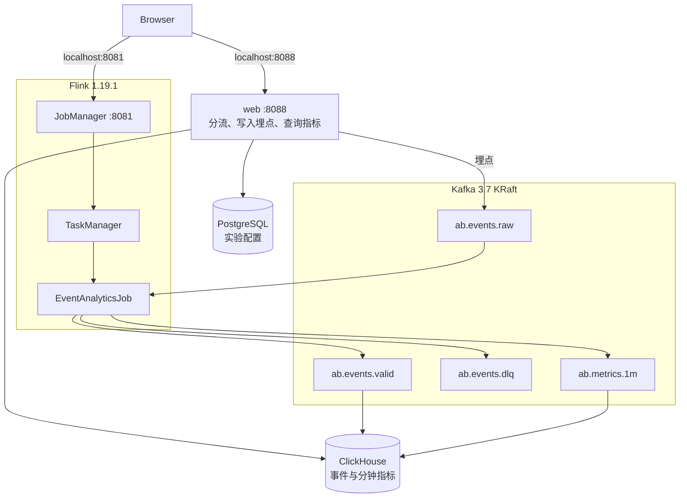

# Flink / Kafka A/B 测试演示

用 Kafka、Flink、PostgreSQL 和 ClickHouse 演示一条完整的 A/B 测试链路：稳定分流、埋点接入、事件校验、去重、归因、分钟聚合，以及实验 Dashboard。

```text
浏览器 SDK -> Spring Boot -> Kafka raw -> Flink -> Kafka valid/metrics -> ClickHouse
                           PostgreSQL 保存实验配置
```

Kafka 是埋点消息总线，把接入、计算和存储拆开。Web 把原始事件写入 `ab.events.raw`，自己不保存事件。Flink 作业 `EventAnalyticsJob` 消费这条流，做校验、去重、归因和分钟聚合，再写回 `ab.events.valid`、`ab.events.dlq` 和 `ab.metrics.1m`。ClickHouse 自己拉取这两个结果 topic：Kafka 表引擎负责消费，物化视图写入 `ReplacingMergeTree`，供 Dashboard 查询。

各 topic 的分工、Flink 四步处理、ClickHouse 落库方式，以及字段变化和指标口径见 [数据模型与端到端数据流](docs/data-model-and-flow.md)。SDK、API 和排查步骤见 [埋点与 A/B 测试](docs/ab-testing-mvp.md)。

## 架构

`event-analytics` 用 `flink run -d` 提交作业后退出，作业继续在 TaskManager 上运行。



| 组件 | 生命周期 | 作用 |
| --- | --- | --- |
| `kafka` | 常驻 | KRaft broker。Compose 内用 `kafka:29092`，宿主机用 `localhost:9092`。 |
| `postgres` | 常驻 | 实验、版本、权重和 payload。 |
| `clickhouse` | 常驻 | 消费有效事件和分钟指标，供 Dashboard 查询。 |
| `web` | 常驻 | 创建四个 A/B topic，提供分流、埋点和查询 API，以及演示页。 |
| `jobmanager` / `taskmanager` | 常驻 | Flink 集群。UI 在 8081。 |
| `event-analytics` | 提交后退出 | 提交 `org.example.ab.EventAnalyticsJob`。同名作业已在运行时跳过。 |
| `EventAnalyticsJob` | 在 TaskManager 上常驻 | 校验、去重、归因，写出有效事件、DLQ 和分钟指标。 |

## 启动

需要 Docker Compose：

```shell
docker compose up --build -d
```

- 实验演示：<http://localhost:8088/ab-demo.html>（首页同样是这个页面）
- 实验 Dashboard：<http://localhost:8088/ab-dashboard.html>
- 分钟指标：<http://localhost:8088/ab-metrics-1m.html>
- Flink UI：<http://localhost:8081>
- Kafka：`localhost:9092`
- PostgreSQL：`localhost:5432/ab_testing`
- ClickHouse HTTP：`localhost:8123`

首次启动时 Flyway 会创建实验表，并写入 `checkout-button` 演示实验。该实验流量为 100%，两个版本权重各为 50。

作业容器里的 `BOOTSTRAP_SERVERS` 会覆盖 `flink-jobs/src/main/resources/config.properties`。

```shell
docker compose exec kafka /opt/bitnami/kafka/bin/kafka-console-consumer.sh \
  --topic ab.events.valid --from-beginning --bootstrap-server localhost:9092

docker compose down
```

改完代码后重新构建。若作业名已在运行，先在 Flink UI 取消旧作业，再执行：

```shell
docker compose up --build -d
```

清空演示数据：`docker compose down -v` 后重新启动。

## Topic

Web 启动时创建，每个 4 个分区：

- `ab.events.raw`
- `ab.events.valid`
- `ab.events.dlq`
- `ab.metrics.1m`

`ab.events.raw` 以 `user_id` 作为 Kafka key。

## 本地打包

Compose 会在镜像里打出 uber JAR。本机需要 JDK 17（Flink 模块编译目标仍是 Java 11）：

```shell
mvn -B -pl flink-jobs -am package -DskipTests
```

产物为 `flink-jobs/target/flink-kafka-demo-1.2.0-all.jar`。Flink 依赖标记为 `provided`，需与集群 1.19.1 一致。
