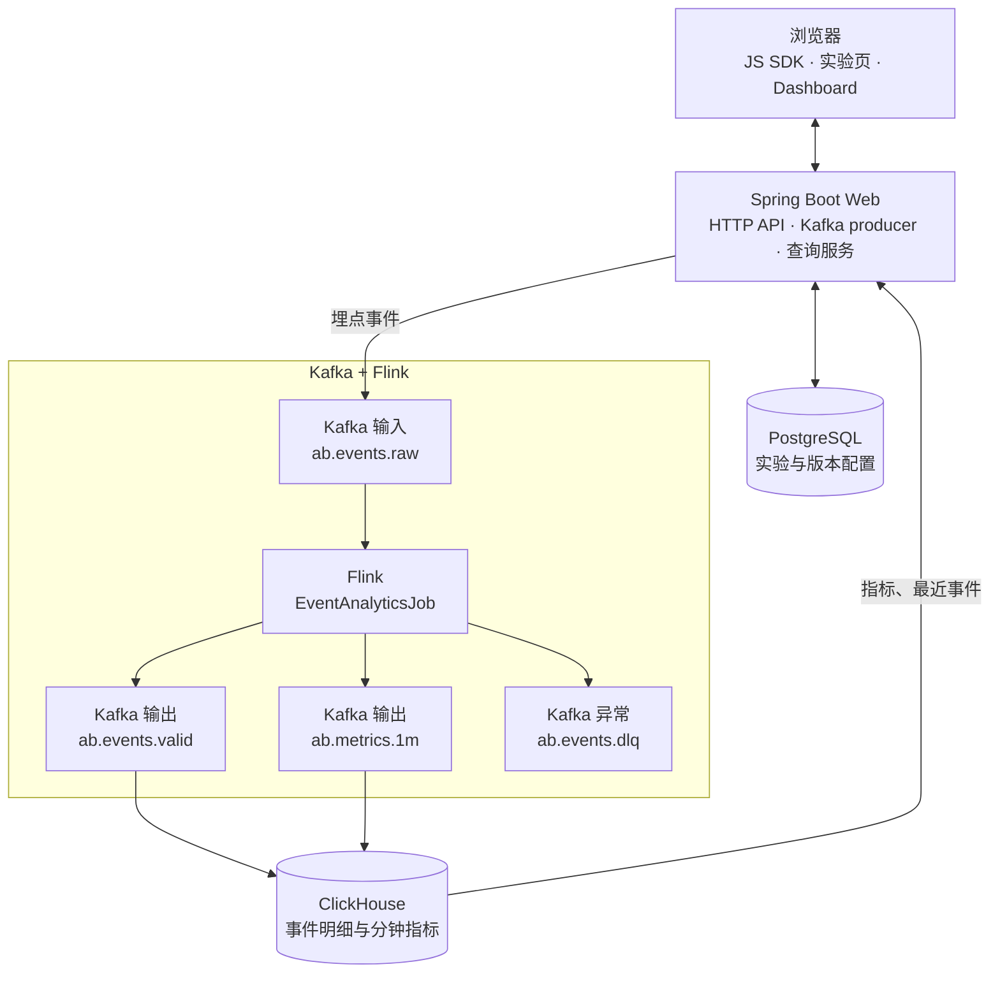
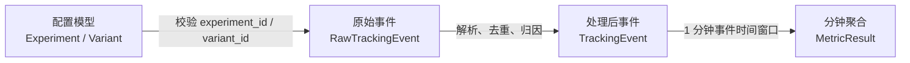
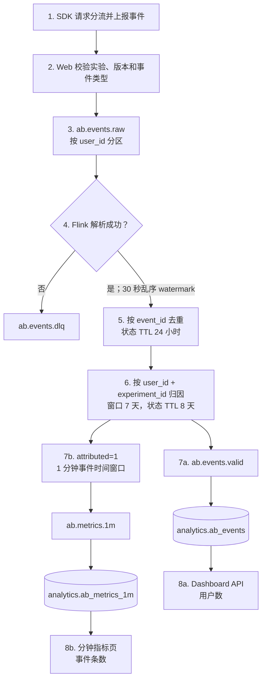

# 数据模型与端到端数据流

本文说明 A/B 测试演示里有哪些数据、经过哪些组件，以及最终查询用什么口径。业务决策本身见 [A/B 测试业务逻辑](ab-business-logic.md)。

## 先看懂这条数据流

Kafka 是埋点的消息总线，Flink 是常驻的实时计算作业。浏览器上报的曝光、点击、购买不会直接写入分析库：Spring Boot 只做接入校验，把事件放进 Kafka；Flink 消费后再清洗、去重、归因并按分钟聚合，结果写回 Kafka，由 ClickHouse 消费后供 Dashboard 查询。

```text
浏览器 SDK → Spring Boot → Kafka raw → Flink → Kafka valid / metrics → ClickHouse
                                      ↘ Kafka dlq
```

Web 本身不保存事件。PostgreSQL 只保存实验、版本、权重和流量配置，不保存埋点事件。

### Kafka：把接入、计算和存储拆开

Web 启动时创建下面四个 topic，每个 4 个分区。生产者和消费者互不直连，所以接入可以先把事件放下，计算和落库各自按自己的速度消费。

| Topic | 谁写入 | 谁消费 | 里面是什么 |
| --- | --- | --- | --- |
| `ab.events.raw` | Web 埋点 API | `EventAnalyticsJob` | 原始埋点。message key 是 `user_id`。 |
| `ab.events.valid` | Flink | ClickHouse | 校验、去重、归因之后的有效事件。 |
| `ab.events.dlq` | Flink | 人工排查 | 解析失败的坏数据，结构为 `raw`、`error`、`failed_at`。 |
| `ab.metrics.1m` | Flink | ClickHouse | 按实验版本聚合的 1 分钟指标。 |

### Flink：`EventAnalyticsJob` 做的四件事

作业消费 `ab.events.raw`，在 TaskManager 上常驻，按顺序做：

1. **校验**。只接受 `exposure`、`click`、`purchase`，并检查必填字段、UUID 和 ISO 时间。解析失败的记录进入 `ab.events.dlq`，不进入后续统计。
2. **去重**。按 `event_id` 去掉重复上报，状态保留 24 小时。
3. **归因**。按 `user_id + experiment_id` 关联曝光和后续行为，归因窗口 7 天。同一用户在窗口内的首次曝光，以及落在该曝光之后、同一版本上的 click / purchase，标记为 `attributed = 1`。
4. **分钟聚合**。只把 `attributed = 1` 的事件按 `(experiment_id, variant_id)` 放进 1 分钟滚动窗口，统计曝光、点击、购买条数和购买金额，写入 `ab.metrics.1m`。

去重和归因之后的每条事件都会写入 `ab.events.valid`，包括 `attributed = 0` 的记录。分钟指标只统计已归因事件。

作业每 30 秒做一次 exactly-once checkpoint，Kafka sink 也使用 exactly-once。字段怎么变、归因判定和查询口径见下文第 2 节到第 5 节。

### ClickHouse：自己拉取 Kafka 并落库

`ab.events.valid` 和 `ab.metrics.1m` 由 `clickhouse-server` 自己消费。服务进程里的后台线程按块拉取消息，物化视图再把这些行插入 `ReplacingMergeTree`。Flink 写到 Kafka 即结束，没有向 ClickHouse 执行 `INSERT`。表之间如何衔接、offset 何时提交，见第 4 节。

## 1. 全局架构



| 组件 | 职责 | 是否保存业务数据 |
| --- | --- | --- |
| 浏览器 / JS SDK | 请求实验版本、渲染版本、上报曝光/点击/购买 | `localStorage` 保存匿名用户 ID，`sessionStorage` 保存会话和曝光标记 |
| Spring Boot Web | 创建 topic、校验请求、写入 Kafka、提供查询 API | 不保存事件 |
| PostgreSQL | 保存实验、版本、权重、流量和版本 payload | 是，实验配置的事实来源 |
| Kafka | 解耦接入、计算和存储 | 是，按 topic 保留消息 |
| Flink | 校验、去重、归因和窗口聚合 | 是，算子状态通过 checkpoint 持久化 |
| ClickHouse | 保存有效事件和分钟指标 | 是，分析查询的存储 |

Compose 以单机方式运行：Kafka 单 Broker，Flink 单 JobManager、单 TaskManager（2 slots），默认并行度为 1。`event-analytics` 提交作业后退出，作业继续在集群中运行。

## 2. 数据模型



### 实验配置：PostgreSQL

`experiments` 保存实验级配置：

- `id`：埋点中的 `experiment_id`；
- `experiment_key`：SDK 请求分流使用的稳定业务键；
- `status`：`DRAFT`、`RUNNING` 或 `PAUSED`；
- `salt`：稳定哈希盐；
- `traffic_percent`：进入实验的流量百分比；
- `created_at`、`updated_at`：配置时间。

`experiment_variants` 保存版本：

- `id`：埋点中的 `variant_id`；
- `experiment_id`：所属实验；
- `variant_key`、`name`：版本键和名称；
- `weight`：版本流量权重；
- `payload_json`：下发给前端的版本配置。

分流使用 `SHA-256(experimentKey:userId:salt)`。配置不变时，同一用户会稳定进入同一版本。PostgreSQL 只负责配置和分流，不存埋点事件。

### 原始事件：API 与 `ab.events.raw`

标准事件只允许 `exposure`、`click`、`purchase`：

| 字段 | 必填 | 含义 |
| --- | --- | --- |
| `event_id` | 是 | UUID，Flink 去重键 |
| `event_name` | 是 | 标准事件名 |
| `event_time` | 是 | 客户端业务事件时间，ISO-8601 |
| `user_id` | 是 | 用户标识，同时是 Kafka message key |
| `session_id` | 否 | 会话标识 |
| `experiment_id` | 是 | 实验 UUID |
| `variant_id` | 是 | 版本 UUID |
| `properties` | 否 | JSON 扩展属性；购买金额取 `amount` |
| `sdk_version`、`page_url` | 否 | SDK 和页面上下文 |
| `received_at` | 服务端生成 | Web 服务接收时间 |

Web 在写入 Kafka 前检查：事件类型受支持、实验正在运行、版本属于该实验。单次请求最多 100 条事件。

### 处理后事件：`ab.events.valid` 与 `analytics.ab_events`

| 字段 | 变化或用途 |
| --- | --- |
| `event_id`、用户/实验/版本字段 | 从 raw 透传 |
| `event_time`、`received_at` | 转为 UTC `yyyy-MM-dd HH:mm:ss.SSS` |
| `properties` | 从 JSON 对象转为 JSON 文本字符串 |
| `attributed` | Flink 归因结果，`0` 或 `1` |
| `version` | `received_at` 的 epoch 毫秒，用于 ClickHouse 替换版本 |

`sdk_version`、`page_url` 不会进入 valid topic。解析失败的数据写入 `ab.events.dlq`，结构为 `raw`、`error`、`failed_at`。

`analytics.ab_events` 使用 `ReplacingMergeTree(version)`，按 `toYYYYMM(event_time)` 分区，按 `(experiment_id, variant_id, event_time, event_id)` 排序。查询使用 `FINAL`。当前未配置 TTL。

### 分钟指标：`ab.metrics.1m` 与 `analytics.ab_metrics_1m`

只对 `attributed = 1` 的事件，按 `(experiment_id, variant_id)` 进入 1 分钟滚动事件时间窗口：

| 字段 | 含义 |
| --- | --- |
| `window_start`、`window_end` | 窗口边界 |
| `experiment_id`、`variant_id` | 聚合维度 |
| `exposures`、`clicks`、`purchases` | 窗口内事件条数，不是 UV |
| `revenue` | purchase 的 `properties.amount` 之和 |
| `version` | 窗口结束时间的 epoch 毫秒 |

`analytics.ab_metrics_1m` 同样使用 `ReplacingMergeTree(version)`，按月分区，并以 `(experiment_id, variant_id, window_start)` 排序。

## 3. 处理流程



1. **解析**：检查必填字段、三个 UUID、事件名和 ISO 时间；错误进入 DLQ。
2. **事件时间**：采用 `event_time`，允许 30 秒乱序；输入空闲 1 分钟后标记 idle。
3. **去重**：按 `event_id` 保存 24 小时状态。TTL 到期后同一 ID 再次出现，仍可能被重新处理。
4. **归因**：同一用户和实验的首个曝光标记为 `attributed = 1`；7 天内后续曝光标记为 `0`，并更新最近曝光。click/purchase 必须不早于最近曝光、间隔不超过 7 天，且 `variant_id` 相同，才标记为 `1`。
5. **输出**：去重后的事件进入 valid；只有 `attributed = 1` 的事件进入分钟聚合。
6. **落库**：ClickHouse 用 Kafka 表引擎消费 valid 和 metrics，物化视图写入 MergeTree。见第 4 节。

作业每 30 秒 checkpoint，Kafka sink 使用 `EXACTLY_ONCE`。ClickHouse 侧是至少一次，再用 `ReplacingMergeTree(version)` 和查询 `FINAL` 合并重复行。

## 4. ClickHouse 如何从 Kafka 落库

`ab.events.valid` 和 `ab.metrics.1m` 的落库发生在 `clickhouse-server` 内部。后台线程作为 Kafka 消费者按块拉取消息，解析后交给物化视图，由物化视图插入真正存数据的表。这是拉取，不是 Kafka 向 ClickHouse 推送。

数据目录为空时，ClickHouse 入口脚本会执行 `docker/clickhouse/init/001_ab_analytics.sql`。每个 topic 对应三张表：

| Kafka topic | Kafka 引擎表 | 物化视图 | 落地表 |
| --- | --- | --- | --- |
| `ab.events.valid` | `analytics.ab_events_kafka` | `analytics.ab_events_mv` | `analytics.ab_events` |
| `ab.metrics.1m` | `analytics.ab_metrics_1m_kafka` | `analytics.ab_metrics_1m_mv` | `analytics.ab_metrics_1m` |

Kafka 引擎表使用 `ENGINE = Kafka`，只声明订阅，不保存行。两张表都连接 Compose 网络内的 `kafka:29092`，格式为 `JSONEachRow`，与 Flink 写出的一行一个 JSON 对应。消费组分别是 `clickhouse-ab-events` 和 `clickhouse-ab-metrics`，每张表 `kafka_num_consumers = 1`。

物化视图定义为 `SELECT *`，列名与 Flink 序列化字段一致。一块消息成功插入落地表之后，ClickHouse 才提交这批 Kafka offset。

offset 在写入之后提交，因此投递语义是至少一次。进程在提交前退出时，同一批消息会再次进入落地表。两张落地表都是 `ReplacingMergeTree(version)`，后台合并时对相同排序键保留 `version` 最大的一行。合并不会在插入当时完成，所以 Dashboard 查询 `analytics.ab_events` 时使用 `FINAL`。

- `analytics.ab_events` 按 `toYYYYMM(event_time)` 分区，排序键是 `(experiment_id, variant_id, event_time, event_id)`。
- `analytics.ab_metrics_1m` 按 `toYYYYMM(window_start)` 分区，排序键是 `(experiment_id, variant_id, window_start)`。

停止消费时分离对应的物化视图；重新挂上后，从该消费组已提交的 offset 继续拉取。

## 5. 查询口径

实验 Dashboard 的 `/api/experiments/{id}/metrics` 不读取 `analytics.ab_metrics_1m`，而是从 `analytics.ab_events FINAL` 计算：

| 指标 | 口径 |
| --- | --- |
| 曝光用户数 | `attributed=1` 的 exposure 用户去重数 |
| 点击用户数 | `attributed=1` 的 click 用户去重数 |
| 购买用户数 | `attributed=1` 的 purchase 用户去重数 |
| CTR | 点击用户数 / 曝光用户数 |
| 转化率 | 购买用户数 / 曝光用户数 |
| 订单数 | 已归因 purchase 事件条数 |
| GMV | 已归因 purchase 的 `properties.amount` 之和 |

分钟指标页 `/ab-metrics-1m.html` 调用 `/api/experiments/{id}/metrics/1m`，读取 `analytics.ab_metrics_1m FINAL`。页面可选最近 60 分钟、24 小时或 7 天，默认是 7 天。表中的 `exposures`、`clicks`、`purchases` 是该分钟内的事件条数，`revenue` 是购买金额。这些计数不能和 Dashboard 的用户数直接比较。

## 6. Topic

| Topic | 分区 | 生产者 | 消费者 | 数据 |
| --- | ---: | --- | --- | --- |
| `ab.events.raw` | 4 | Tracking API | `EventAnalyticsJob` | 原始事件 |
| `ab.events.valid` | 4 | `EventAnalyticsJob` | ClickHouse Kafka Engine | 有效事件 |
| `ab.events.dlq` | 4 | `EventAnalyticsJob` | 人工排查 | 无效事件 |
| `ab.metrics.1m` | 4 | `EventAnalyticsJob` | ClickHouse Kafka Engine | 分钟指标 |

消息均为 JSON 文本。

## 7. 设计边界

1. 时间格式会被改写，`properties` 从对象变成字符串，`sdk_version` 和 `page_url` 被丢弃。
2. 去重状态 24 小时，归因窗口 7 天。24 小时后重放相同 `event_id` 可能再次参与统计。
3. ClickHouse 没有 TTL，演示数据会一直保留。
4. Kafka 和数据库都是单节点，topic 副本数为 1。
5. ClickHouse 消费 Kafka 是至少一次。offset 提交前进程退出时，同一批消息会再次插入；`ReplacingMergeTree(version)` 在合并后保留 `version` 较大的行。

## 8. 代码导航

| 主题 | 关键文件 |
| --- | --- |
| 容器和运行拓扑 | `docker-compose.yml` |
| Topic 配置和创建 | `sales-web/src/main/resources/application.yml`、`sales-web/src/main/java/org/example/web/KafkaSetup.java` |
| 实验配置 | `sales-web/src/main/resources/db/migration/V1__experiments.sql` |
| 埋点 API | `sales-web/src/main/java/org/example/web/tracking/` |
| Flink 作业 | `flink-jobs/src/main/java/org/example/ab/EventAnalyticsJob.java` |
| ClickHouse 表和摄入 | `docker/clickhouse/init/001_ab_analytics.sql` |
| Dashboard 与分钟指标查询 | `sales-web/src/main/java/org/example/web/analytics/AnalyticsRepository.java`、`sales-web/src/main/resources/static/ab-metrics-1m.html` |
